# Cloud Computing Assignment 01
**Student Name:** Areeba Habib  
**Registration No:** FA24B1-SE-011  

## Task 1: Local Gitea Environment Setup
Local Gitea server setup, repository creation, and initial push verification.

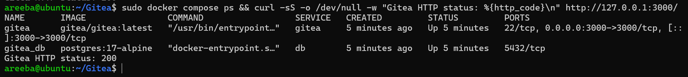
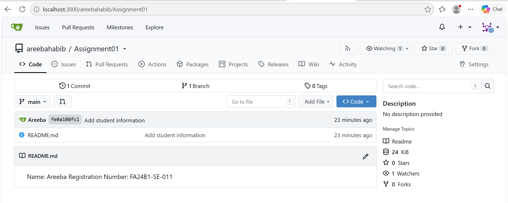
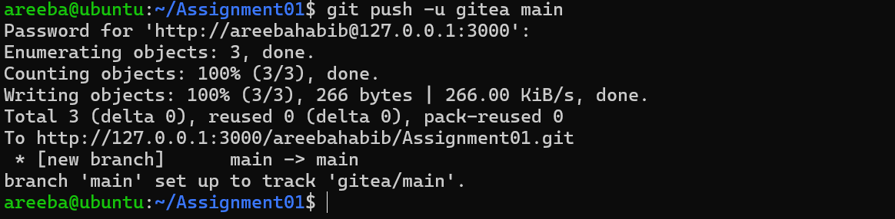

## Task 2: Remote Synchronization with GitHub
Configuring dual remotes (Gitea and GitHub) and synchronizing repository branches.

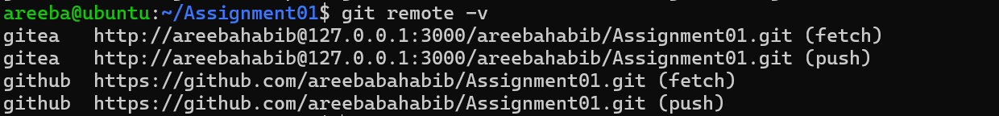
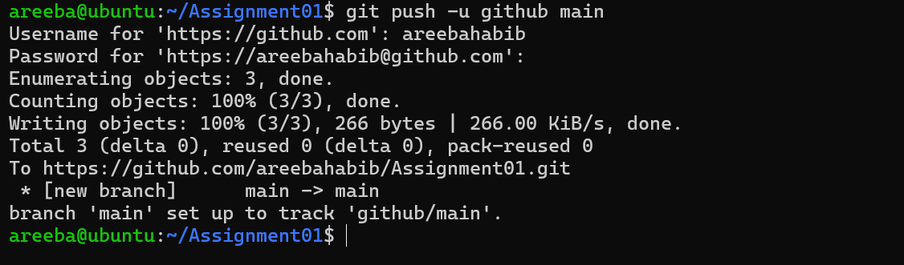
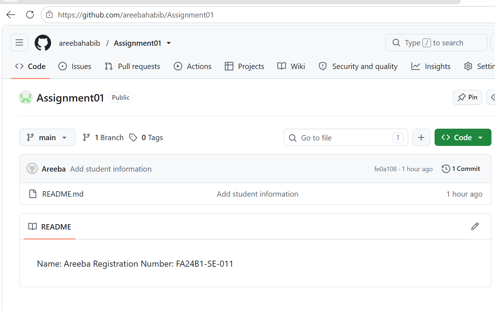

## Task 3: Git LFS Tracking
Configuring Git LFS tracking for 100MB+ binary files and pushing large assets.

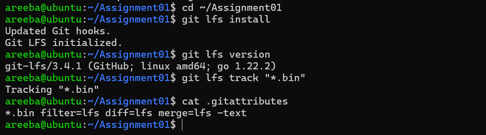
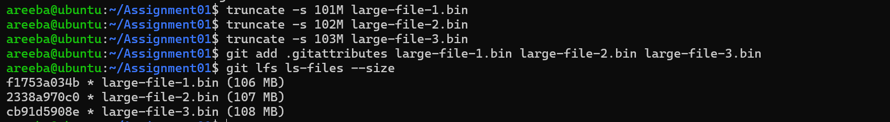
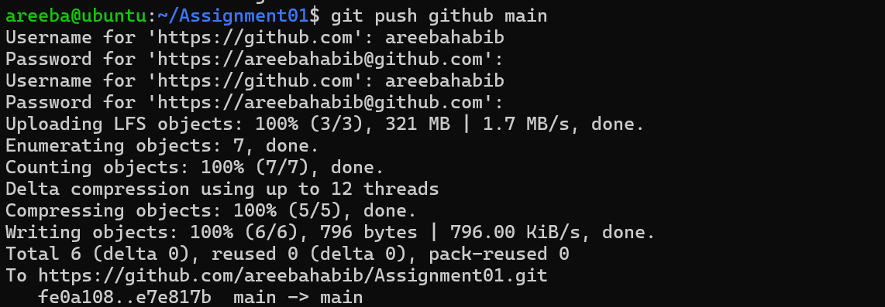

## Task 4: Portfolio Deployment via GitHub Pages
Deploying the static portfolio site on GitHub Pages and verifying live availability.

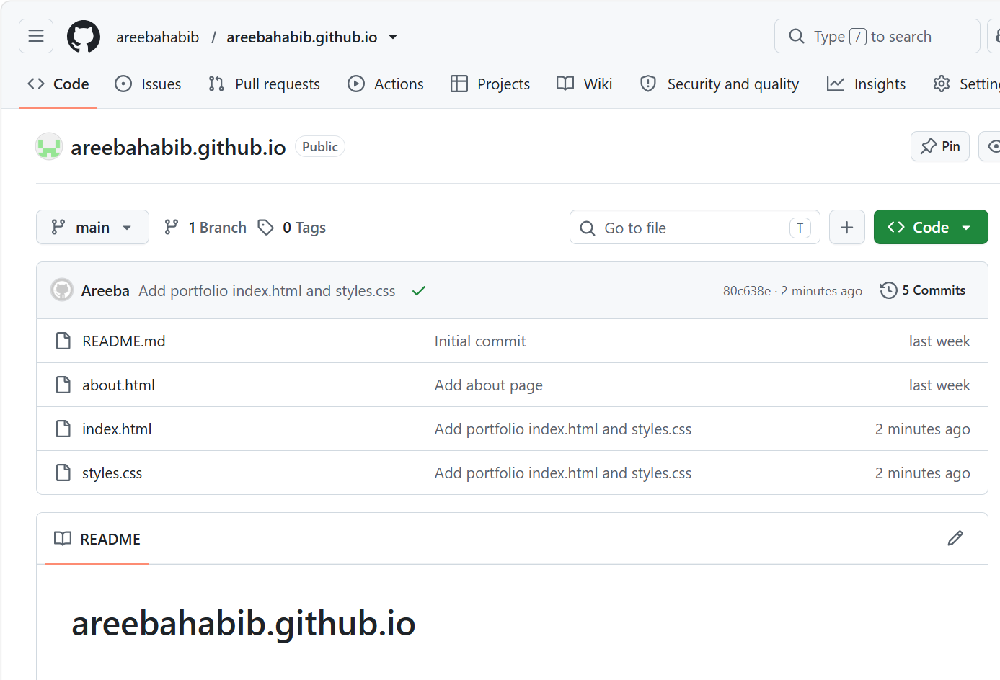
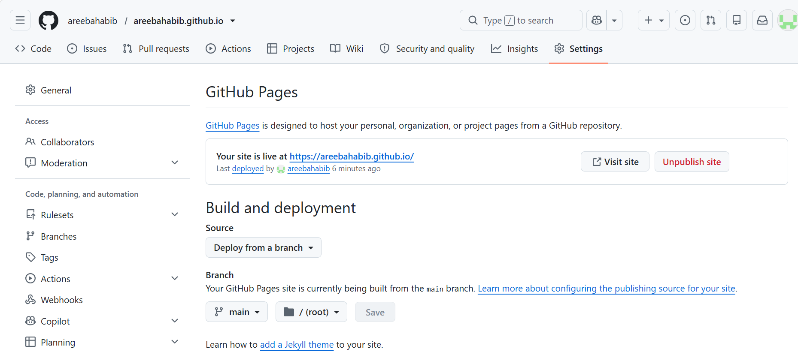
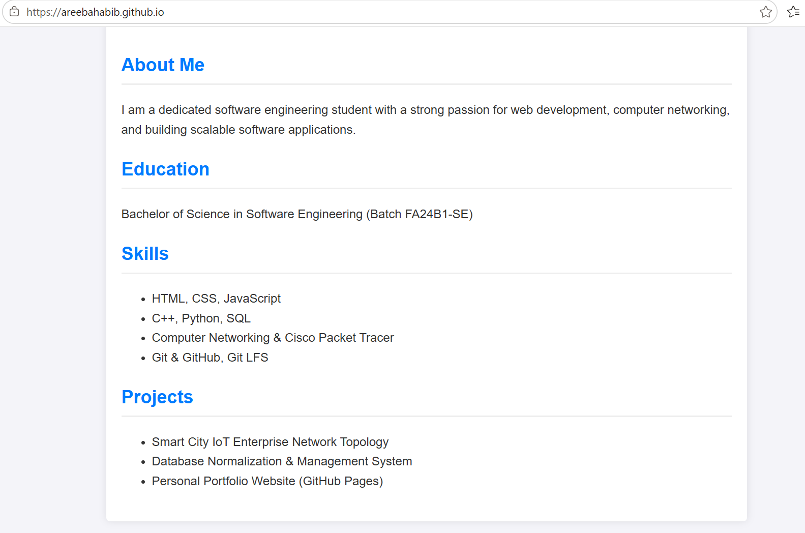
